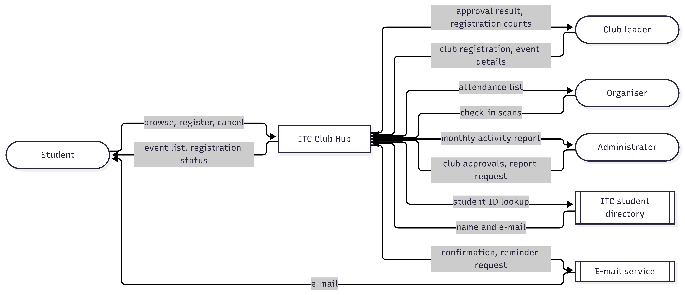
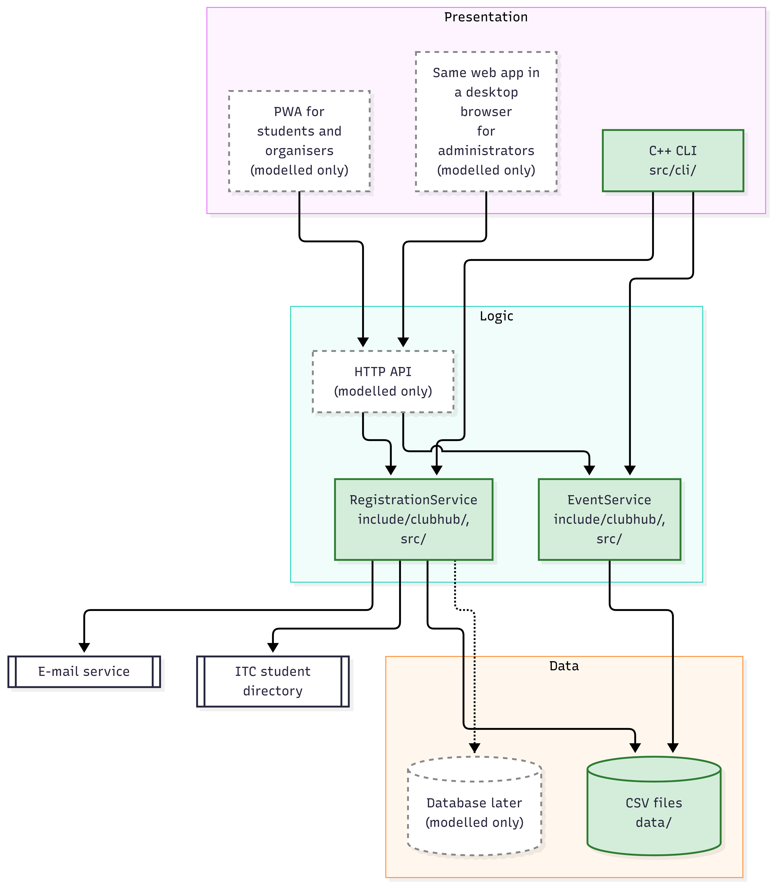

# Lab-02 · Types of Applications
Version 1.0 · 2026-11-04 · Team: HEHE

## File Table
| File | Description | Main author |
| :--- | :--- | :--- |
| `lab02/app-classification.md` | Five everyday applications classified by type, architecture, and qualities | Sinath Naihouy, Mony Viseth Setha, Sov Kenkimseng, Phou Sekang (one row each) |
| `lab02/app-quadrant.mmd` | Mermaid quadrant chart comparing timing vs. availability | Sinath Naihouy |
| `lab02/adr-001-application-type.md` | Architecture decision record for Club Hub application types | Sinath Naihouy |
| `lab02/quality-scenarios.md` | Six quality attribute scenarios with testable metrics | Sinath Naihouy, Mony Viseth Setha, Sov Kenkimseng, Phou Sekang (see "written by" in the file) |
| `lab02/context-diagram.mmd` (+ .png) | Black-box context diagram showing actors and external systems | Mony Viseth Setha |
| `lab02/architecture.mmd` (+ .png) | Three-tier architecture sketch mapping implemented components | Mony Viseth Setha |
| `include/clubhub/event.hpp` | Event domain model header and time point formatting | Sov Kenkimseng, Phou Sekang |
| `include/clubhub/event_csv.hpp` | CSV parser result structures and interface declaration | Sov Kenkimseng, Phou Sekang |
| `src/event.cpp` | Event validation logic and time string parsing implementation | Sov Kenkimseng, Phou Sekang |
| `src/event_csv.cpp` | CSV line-by-line file parser with robust error handling | Sov Kenkimseng, Phou Sekang |
| `src/cli/main.cpp` | Command-line front end implementing `list-events` | Sov Kenkimseng, Phou Sekang |
| `CMakeLists.txt` | Build targets `clubhub_core` (library) and `clubhub` (executable) | Sov Kenkimseng, Phou Sekang |
| `data/events.csv` | Sample event dataset including valid records and the invalid row E004 | Sov Kenkimseng, Phou Sekang |
| `lab02/offline-checkin.md` | Offline-first check-in: sequence diagram, conflict rules, QAS-07 | Phou Sekang, Sov Kenkimseng |
| `include/clubhub/queued_checkin.hpp` | `QueuedCheckIn` struct and `CheckInQueue` class for the offline queue | Phou Sekang, Sov Kenkimseng |

## Inputs Reused from Lab-01
| Input File | What We Used From It | Commit Hash / Version |
| :--- | :--- | :--- |
| `lab01/team-charter.md` | Problem statement, stakeholder list, and target user groups | `e35867b` |
| `lab01/decisions.md` | Team decision rules and consensus guidelines | `c278399` |

## Architecture Diagrams
### Context Diagram

### Three-Tier Architecture

## Change Log
| Date | Version | Description | Author |
| :--- | :--- | :--- | :--- |
| 2026-10-20 | v0.1.0 | Team, repository, failure analysis, problem statement, first build (Lab-01) | Team HEHE |
| 2026-11-04 | 1.0 | Lab-02: tasks 1 to 5 (classification, ADR-001, quality scenarios, diagrams, event core and `list-events` CLI) and the offline check-in challenge | Team HEHE |