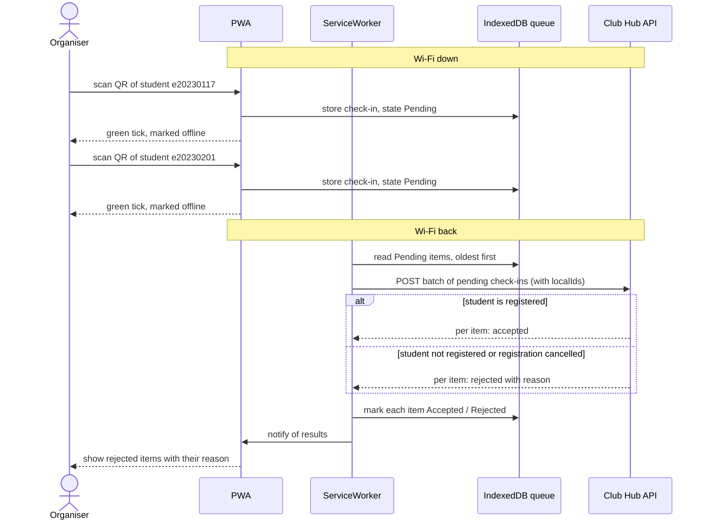

# Lab-02 Challenge · Offline-first check-in for the Club Hub PWA
   Version 1.0 · 2026-11-04 · Team: Team3
## 1. Sequence diagram

The sync starts when the browser fires the online event or when the app is opened, because Safari on iPhone does not support Background Sync.

## 2. Conflict rules
| # | Case | Winner | Organiser sees | Stored on the server |
|---|------|--------|----------------|----------------------|
| 1 | Same student scanned at door 1 and door 2 | The first upload the server receives | "Already checked in" (not an error, the student really arrived) | One CheckedIn record; the second scan is logged as a duplicate |
| 2 | Registration cancelled on the server before the sync | The server (the cancellation) | A warning "registration cancelled" so the organiser decides at the door | Registration stays Cancelled; the attempt is logged as rejected |
| 3 | Student not registered | The server | A flag "not registered" | No registration is created; the attempt is logged as rejected |
| 4 | Upload retried after a timeout, the server had already applied it | The first copy | Nothing new, the item shows as accepted | The server keeps a set of applied localIds; a second POST with the same localId returns "accepted" again without a second record |
| 5 | Phone clock is 7 minutes wrong | The server's clock (receivedAt) decides the order | Nothing, unless the scan falls outside the event time | Both scannedAt (device) and receivedAt (server) are stored |

## 3. Data structure

The header is `include/clubhub/queued_checkin.hpp`. `QueuedCheckIn` is one check-in recorded on an organiser's phone while offline. `CheckInQueue` keeps these items in order, oldest first, and marks each one accepted or rejected after the sync.

```cpp
enum class SyncState { Pending, Sent, Accepted, Rejected };

struct QueuedCheckIn {
    std::string localId;     // UUID made on the device at scan time; never changes on retry
    std::string deviceId;    // which phone made the scan
    std::string eventId;
    std::string studentId;
    std::chrono::sys_seconds scannedAt;  // device clock: may be wrong, so the server also stores receivedAt
    int attempts{0};         // number of upload attempts so far
    SyncState state{SyncState::Pending};
    std::optional<std::string> rejectReason;  // set by the server when state is Rejected
};
```

**Idempotency key:** the field that makes a retry safe is `localId`. It is a UUID generated once on the device at scan time and reused on every retry. The server applies each `localId` at most once and answers "accepted" again for a repeat, so a retry after a timeout never creates a second check-in. A simple counter would not work, because two phones could produce the same number. `studentId + eventId` is not a good key either: that is the business rule from conflict case 1 (one check-in per student per event), not protection against retries.

## 4. Effect on QAS-01..06

- **Improves QAS-02 (check-in performance):** the green tick no longer waits for the network.
- **Does not change QAS-01 (availability of registration):** QAS-01 is about students registering, not check-in. Check-in availability is covered by the new QAS-07.
- **Makes QAS-04 (security) harder:** student data is now stored on the organiser's phone in IndexedDB, so it must be protected and deleted after the sync.
- **Makes QAS-05 (modifiability) harder:** the queue, the sync and the conflict rules add code that must be maintained.
- **Makes QAS-06 (portability) harder:** Service Worker and sync behaviour differ between Chrome on Android and Safari on iPhone.

## 5. New scenario QAS-07

### QAS-07 · Availability of check-in during a network outage · written by Phou Sekang
| Part | Content |
|---|---|
| Source | An organiser at the door of Amphi A |
| Stimulus | Scans student QR codes while the Wi-Fi is down for 5 minutes |
| Environment | Debate Night, 120 arrivals in 10 minutes, two doors, one phone each, 5-minute outage |
| Artifact | PWA check-in screen, IndexedDB queue and sync |
| Response | Every scan shows a green tick immediately and is queued; after the network returns, all queued items are uploaded and each gets a final status |
| Response measure | Tick shown in at most 1 second for 95% of scans; every queued item is Accepted or Rejected within 60 seconds after reconnection; 0 check-ins lost; 0 duplicate records stored on the server |