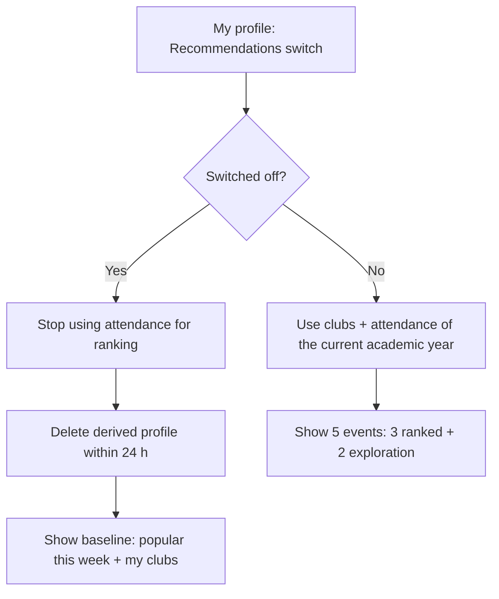

# AI feature proposal: "Recommended for you"
Version 1.0 · 2026-11-21 · Authors: Mony Viseth Setha, Phou Sekang, Sinath Naihouy, Sov Kenkimseng (Team HEHE)

## 1 Problem and non-personalised baseline

**User problem.** Students do not know which of the many club events fit them, so they miss events or only see the clubs they already follow. The clubs office wants better attendance, especially for small clubs.

**Baseline (no personal data).** Two lists that need nothing about the student:
- "Popular this week": the five upcoming events with the most registrations (counts only, no names).
- "Events of my clubs": upcoming events from clubs the student has already joined.

The baseline solves part of the problem (visibility) with no new data and no new risk. Personalisation must prove it adds value beyond it.

## 2 Data needed

Linked to `lab03/data-inventory.md` (Task 1).

| Field | Source | In inventory? | New purpose / consent? | Minimisation |
|-------|--------|---------------|------------------------|--------------|
| studentId | registration | Yes (Mask) | No new purpose if kept inside the service | Pseudonymous key; masked form only in logs; never shown in the output |
| clubMemberships | membership records | Yes (Keep) | Yes: used for ranking, so explicit opt-in | Current memberships only |
| attendance | check-in records | Yes (Aggregate) | Yes: used for ranking, so explicit opt-in | Current academic year only (the retention period in `retention-rules.md`); event and club IDs, no free text |
| name | profile | Yes (Keep) | No | Not used by the recommender |
| email | profile | Yes (Keep) | No | Not used by the recommender |
| phone | profile | Yes (Keep optional) | No | Not used; never used to send recommendations |
| dateOfBirth, photo, facultyAndYear, telegramHandle | not collected | No (Drop / Aggregate) | n/a | Stay out: no feature needs them, and they invite unfair profiling |

**Effect on Task 1:** `attendance` gets a second purpose (recommendations, with consent). If the team goes ahead, the inventory gets a new row `recommendationProfile`: derived from clubs and attendance, deleted within 24 hours of opt-out. No dropped field is reintroduced.

## 3 Bias risks

| Risk | Who is harmed | Mitigation | Fairness check (metric, threshold) |
|------|---------------|------------|------------------------------------|
| Cold start: new students, and everyone at the start of an academic year, have no history | New students, first-years | Show the baseline until there are 3+ attendance records; ask for no extra data | Share of new students who see at least 3 events from different clubs ≥ 90 % |
| Popularity feedback loop: popular events get shown, so they get more attendance | Small and new clubs | Reserve 2 of the 5 slots for exploration (clubs the student has never attended) | Clubs with fewer than 20 members receive ≥ 80 % of their fair share of recommendations (fair share = their share of upcoming events) |
| Attendance as a proxy for money, distance or disability | Students with fewer resources, mobility limits, or care duties | Do not read low attendance at paid or far-away events as lack of interest; show cost and accessibility info; allow "not for me" feedback | Recommendation rate for free vs. paid events differs by less than 10 percentage points; same check for on-campus vs. off-campus |
| Large clubs crowd out small ones | Small clubs | Cap two events per club in any list of five | No club has more than 40 % of all recommendations shown in a month |
| Echo chamber: students only see what they already attend | Students who want new interests | Same exploration slots; "Not interested" removes a club for that student | At least 2 of 5 slots per list come from clubs new to the student |

## 4 Transparency

**"Why am I seeing this?" example (Robotics Workshop):**
"You are seeing this because you attended 2 events by the Robotics Club this academic year. You can turn off recommendations at any time in *My profile → Recommendations*."

**Ranking inputs the clubs office will publish:**
1. Clubs the student has joined.
2. Number of events attended per club in the current academic year.
3. Event date (sooner events rank higher).
4. Exploration slots: random events from clubs the student has not attended, chosen so that small clubs get their fair share.

Not used: name, email, phone, gender, age, faculty, or any data outside Club Hub.

## 5 Opt-out design

Design choice: **opt-in, off by default.** Attendance and memberships are used for a new purpose, so consent must be explicit and a student who ignores the screen gets the baseline.

The switch lives in *My profile → Recommendations* (web and mobile) and in the CLI as `clubhub recommendations off`. Switching it off deletes the student's derived profile within 24 hours and stops further recommendations; the underlying registrations and attendance records stay, because other features need them.

## 6 Recommendation

Decision: **GO WITH CONDITIONS**, not before Sprint 2, and only after the baseline has been live for one month and we can compare against it.

Conditions:
1. Opt-in, off by default; switching off deletes the derived profile within 24 hours.
2. Inputs limited to club memberships and attendance of the current academic year; no phone, email, or free-text data.
3. At least 2 of the 5 slots come from clubs the student has never attended.
4. Monthly exposure check: clubs with fewer than 20 members receive at least 80 % of their fair share; the other checks in section 3 are reported in the same monthly report.
5. If a check fails two months in a row, recommendations are switched back to the baseline until fixed.

Owner of the fairness check: clubs office (administrator); the team provides the report query.

## Open questions for the client
- Who at the clubs office will own the monthly fairness report?
- Are "paid" and "off-campus" recorded on events, so those checks can be calculated?